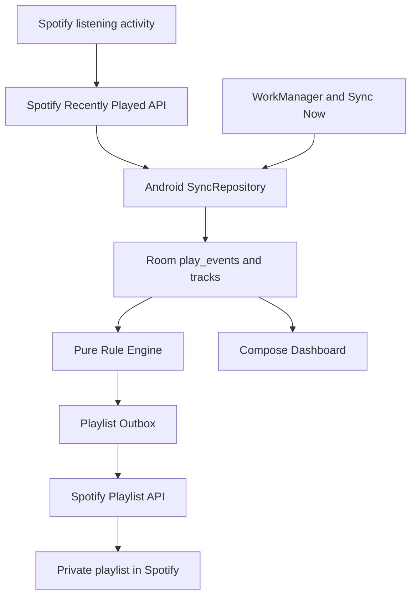
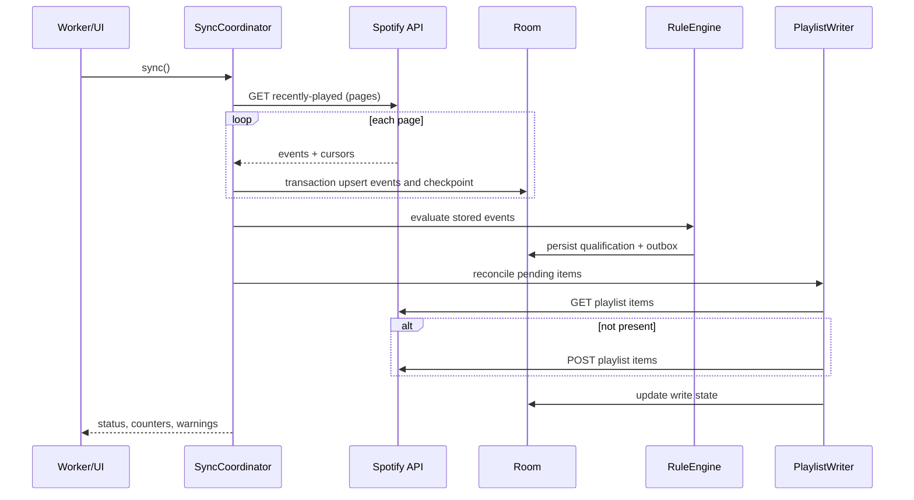
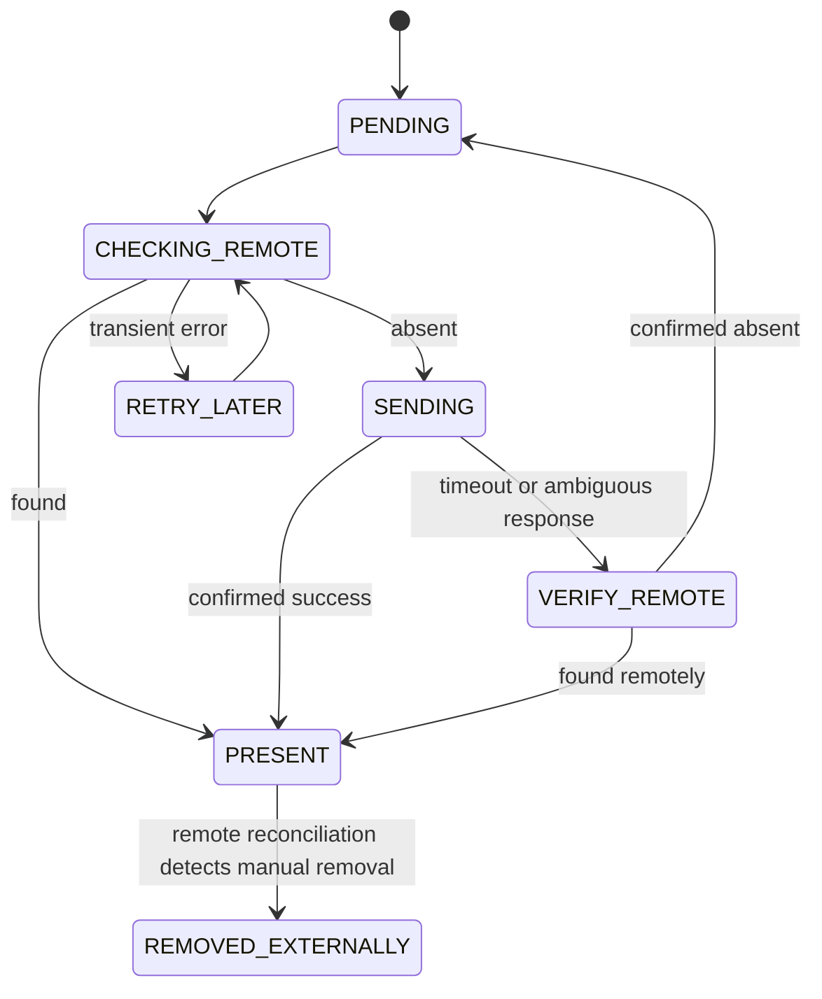

# 03 — Architecture & Runtime Behavior

Version 1.1.0 · Status: Baseline

## 1. System context


## 2. Modules / package boundaries
```text
com.example.spotifyautoplaylist/
  app/               MainActivity, DI wiring, navigation
  auth/              PKCE, callback listener, token repository
  spotify/           Retrofit interfaces, DTOs, error mapping
  data/local/        Room entities, DAO, migrations, DataStore
  data/repository/   SyncRepository, PlaylistRepository
  domain/model/      PlayEvent, Track, Qualification
  domain/rules/      Pure RuleEvaluator (no Android dependencies)
  domain/usecase/    SyncHistory, EvaluateRules, ReconcilePlaylist
  worker/            PeriodicSyncWorker, worker scheduling
  ui/                Compose screens, ViewModels, UI states
```
Dependency direction: UI → use cases → repositories → data sources; domain has no Retrofit/Room/Android dependencies. WorkManager calls the same use cases as Sync Now. Use a mutex/unique work name so only one sync per account runs at a time.

## 3. Sync pipeline


## 4. Recently Played pagination strategy
Spotify exposes `limit <= 50`, `after` and `before` cursors; they cannot be sent together. **Do not assume `after` + a single response is sufficient to recover a long gap.**

Algorithm:
1. On first sync, request newest page (`limit=50`), then follow `next` / `before` backwards while pages exist and a bounded bootstrap budget remains; persist available history, mark coverage as `PARTIAL_BOOTSTRAP` if truncated.
2. Subsequent syncs: fetch newest page and paginate backwards until reaching the last committed high-water timestamp **with overlap** (include equality boundary and deduplicate) or until API returns no older pages / a safe page cap. If the cursor semantics are inconsistent, use documented `before` timestamps with tests, not guessed offsets.
3. Commit every page and progress transactionally; advance global high-water only after all pages needed to bridge the previous watermark were successfully processed.
4. If page cap, rate/quota restriction, empty unexpected page, or unavailable older history prevents bridging, mark `HISTORY_INCOMPLETE` with gap bounds if known. Never claim full history.
5. A manual sync can retry gaps only to the extent the API still exposes them; do not promise restoration.

Recommended page cap: 20 per run (configurable internally, not UI); stop on repeated cursor/no progress. Backoff and quota handling can end earlier. Dedup means overlapping fetches are safe. Consider Spotify's history-retention behavior an **external unknown** to verify empirically.

## 5. Playlist write state machine

Do not auto-re-add `REMOVED_EXTERNALLY`. If playlist is deleted, pause writes and request relink/recreation confirmation.

## 6. Scheduling
- Unique periodic WorkManager task `spotify-autoplaylist-periodic-sync` every ~30 minutes, requires network. Android may defer execution; no exact SLA.
- One-time unique `Sync Now` work, optionally expedited when appropriate, serialized with periodic work.
- On app launch: show cached data immediately; enqueue sync if authenticated and last successful sync older than a configurable freshness target (e.g. 10 minutes), avoiding quota abuse.
- Persist retry intent; use WorkManager exponential backoff for transient failures; honor API `Retry-After` where applicable.
- OxygenOS background restrictions may prevent regular sync; app surfaces last-run timestamp and manual action. No battery-optimization bypass request in MVP.

## 7. Failure boundaries
- Network failures: do not alter qualification data; keep outbox.
- Crash mid-page: Room transaction either commits page + cursor or neither.
- Crash after POST: mark `VERIFY_REMOTE` before send; remote read resolves ambiguity on restart.
- Auth 401: one serialized refresh attempt, then re-auth UI.
- 403: display permission/eligibility error; do not endlessly retry.
- 429: parse `Retry-After`, distinguish `QUOTA_EXCEEDED`, suspend requests accordingly.
- Spotify account mismatch: stop and isolate existing data.

## 8. Security & observability
Use TLS, PKCE S256, cryptographic `state`, exact redirect validation. Never log auth code, access token, refresh token, request Authorization header or user-private data. Store encrypted tokens with Keystore-backed mechanism; exclude tokens from Android backup. Diagnostic events: sync start/end, page count, imported count, duplicate count, qualification count, playlist write state and sanitized HTTP status.

## 9. Explicit non-goals
No background foreground-service media monitoring, no playback interception, no real-time guarantee, no remote server, no automatic playlist deletion.
