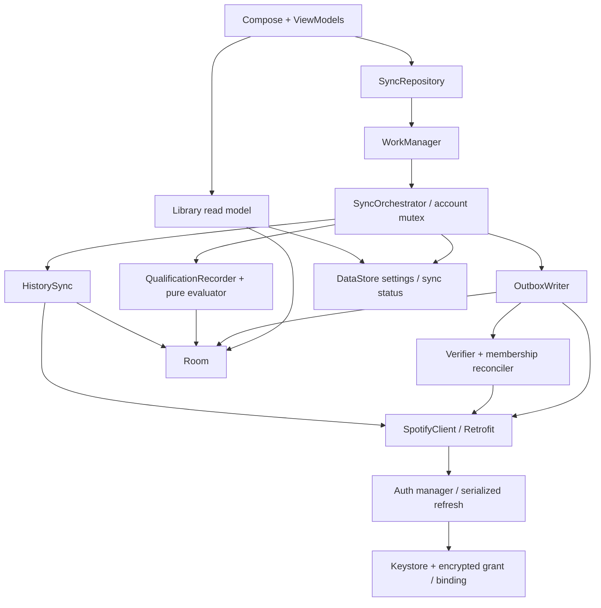

# Codebase Analysis Report - Spotify AutoPlaylist

## Overview

| Field | Value |
|---|---|
| Repository | SpotifyAutoPlaylist / replay. |
| Repository Type | Single System — Android app, 4 Gradle modules |
| Date | 2026-11-05 (UTC+7) |
| Analyzed By | Codex; static review và local verification |

Revision được đánh giá: `b76f67b`. Working tree sạch trước khi review. Không sửa production code.
Đã đọc yêu cầu, luồng auth/history/qualification/outbox/worker, read model, UI và CI.
Đây là review kỹ thuật, không phải chứng nhận release hay kiểm toán bảo mật đầy đủ.

**Nhận định:** nền tảng kỹ thuật tốt cho app cá nhân; thiết kế recovery và kiểm thử sâu hơn
một prototype thông thường. Tuy nhiên còn lỗi ở ranh giới giữa các lớp và thiếu nghiệm thu thực tế.
Điểm tham khảo: kiến trúc 8/10, kiểm thử tự động 8/10, bảo mật thiết kế 8/10,
độ hoàn thiện luồng sử dụng 6/10. Đây là đánh giá định tính, không phải coverage đo được.

## Repository Structure

### Type & Layout

Ứng dụng Android local-first; không có server riêng. Khoảng 7.008 dòng Kotlin production trong
60 file và 50 file Kotlin test; đếm tĩnh được 407 annotation `@Test` (không thay cho số test chạy).
Tài liệu được chia theo requirement và milestone, có phân biệt JVM/device/live evidence.

### Key Directories

| Directory | Purpose | Layer/App |
|---|---|---|
| `auth-core/` | PKCE, loopback, credential/binding store, refresh; cả M0 probe cũ | JVM auth |
| `spotify-api/` | Retrofit, DTO, error mapping, history sync, pure rule engine | JVM integration/domain |
| `data/` | Room, DAO/transactions, DataStore | Android persistence |
| `app/` | Wiring, worker, orchestration, playlist writer, Compose/UI state | Android application |
| `docs/` | Requirements, traceability, evidence, runbooks | Product/engineering |
| `design/reference/` | 8 WebP concept references | Design |

### Where Things Live

| Concern | Location |
|---|---|
| Dependencies | `gradle/libs.versions.toml`, module build scripts, 5 committed lockfiles |
| Scripts | `gradlew`, `scripts/release.sh` |
| Unit Tests | `auth-core/src/test`, `spotify-api/src/test`, app read-model tests |
| Integration Tests | Room/Robolectric, MockWebServer, recovery suites trong các module |
| E2E Tests | Manual runbook `docs/M5-DEVICE-E2E.md`; chưa có kết quả cho bản hiện tại |
| Infrastructure | `.github/workflows/android-ci.yml`, `release.yml` |

## Dependencies Analysis

### Core Dependencies

| Dependency | Version | Purpose | Up-to-date? |
|---|---|---|---|
| JDK / Gradle / AGP | 17 / 8.13 / 8.13.2 | Build | Pinned; không audit latest |
| Kotlin | 2.2.21 | Language/Compose compiler | Pinned |
| Compose BOM | 2025.12.00 | Native UI | Pinned |
| Coroutines | 1.10.2 | Async, Flow, Mutex | Pinned |
| Retrofit / OkHttp | 3.0.0 / 4.12.0 | REST | Pinned |
| Room / KSP | 2.8.5 / 2.2.21-2.0.5 | SQLite/generated DAO | Pinned |
| DataStore | 1.2.1 | Account settings/sync status | Pinned |
| WorkManager | 2.11.2 | Best-effort scheduling | Pinned |
| Robolectric / JUnit | 4.16.1 / 4.13.2 | JVM Android tests | Pinned |

### Outdated / Risky Dependencies

| Dependency | Current Version | Latest Version | Risk Level | Notes |
|---|---|---|---|---|
| Kotlin–AGP combination | 2.2.21–8.13.2 | Không khảo sát | Medium | README đã ghi giới hạn support table; giữ kiểm chứng build thay vì nâng phiên bản đồng loạt |
| Dependency provenance | Lockfiles | Không áp dụng | Low | Có pin/lock; chưa thấy Gradle dependency verification metadata hay bot theo dõi update |

Không kết luận package lỗi thời hoặc có CVE nếu chưa audit nguồn upstream. Có 25 library alias
trong catalog; BOM và test libraries cũng nằm trong số này, không phải 25 runtime dependencies.

## Available Scripts

### Application Scripts

| Script | Command | Description |
|---|---|---|
| Debug APK | `./gradlew :app:assembleDebug` | APK cài thử |
| Release variant | `./gradlew :app:assembleRelease` | Có thể unsigned nếu thiếu key |

### Quality Assurance Scripts

| Script | Command | Description |
|---|---|---|
| Full local checks | `./gradlew :auth-core:test :spotify-api:test :data:testDebugUnitTest :data:lintDebug :app:testDebugUnitTest :app:lintDebug :app:assembleDebug` | JVM, Robolectric, lint, APK |
| UI render artifacts | Thêm `-Preplay.screenshots=<output-dir>` khi chạy UI tests | Synthetic state PNG; chưa có baseline-diff gate |
| CI | `.github/workflows/android-ci.yml` | Thêm release assembly, schema diff và signature/artifact identity |

### Other Scripts

| Script | Command | Description |
|---|---|---|
| Signed release | `scripts/release.sh` | Kiểm tra signing, checksum, source commit; không chạy trong review |
| Manual release CI | `release.yml` / workflow dispatch | Protected environment, runner-temp key, cleanup |

## High-Level Architecture

### Architecture Diagram

### Communication Patterns

| Pattern | Used Between | Protocol/Library |
|---|---|---|
| UI state | ViewModel → Compose | StateFlow, lifecycle-aware collection |
| Local data | Repositories → persistence | suspend Room queries / DataStore Flow |
| Remote calls | Client → Spotify | HTTPS REST, Retrofit/OkHttp |
| Background execution | UI/startup → worker | Unique WorkManager work |
| Crash recovery | Writer → next sync | Durable outbox states, remote reconciliation |

Điểm mạnh: không gọi mạng trong transaction; page import và qualification/outbox có transaction;
single-flight theo account; POST mơ hồ không retry mù. Điểm yếu: domain nằm trong `spotify-api`,
và ranh giới auth → worker → UI chưa được kiểm thử xuyên suốt ở các failure transition.

## Backend Analysis

| Aspect | Details |
|---|---|
| Technology | Kotlin trong Android; không có remote backend |
| Framework | Coroutines, Retrofit, Room, WorkManager |
| Architecture Pattern | Layered, repositories, read model, transactional outbox |
| Code Organization | Module + responsibility packages |
| Database | App-private SQLite |
| ORM / Query Pattern | Room; account predicates; composite keys; exported v1 schema |
| Authentication | PKCE; AES-GCM/Android Keystore; refresh mutex |
| Authorization | Expected owner match, persistent account binding, owned/private playlist gate |
| Deployment | APK sideload |

### Backend Modules/Services

| Module/Service | Path | Responsibility |
|---|---|---|
| History | `spotify-api/.../sync/HistorySync.kt` | Backward pagination, overlap/watermark, coverage |
| Rules | `spotify-api/.../rules/QualificationEvaluator.kt` | VN day, exclusive rolling lower boundary, earliest qualification |
| Writes | `app/.../playlist/` | Verify owner/privacy, reconcile, journal, batches ≤100 |
| Persistence | `data/.../local/Daos.kt` | Atomic import, qualification, reconcile and claim/settle |

## Frontend Analysis

| Aspect | Details |
|---|---|
| Framework | Jetpack Compose |
| Communication Pattern | UI actions → app repositories; immutable library snapshots |
| UI Library | Material3 + Replay tokens/components |
| State Management | ViewModel StateFlow + rememberSaveable drafts/filters |
| Authentication Library | Project-owned auth core |
| Query Library | Room/DataStore through `RoomLibrarySource` |
| Architecture Pattern | Four-tab scaffold, secondary Settings, onboarding wizard |
| Deployment | Native APK |

### Frontend Apps/Packages

| App/Package | Path | Responsibility |
|---|---|---|
| UI | `app/.../ui/` | Home, History/detail, Collection, Rules, Settings |
| Read model | `app/.../library/` | Counts, filtering, status copy, sanitized diagnostics |
| Onboarding | `app/.../onboarding/` | OAuth + confirmed create/link + recovery journal |

UI có native widgets, empty/unknown/partial states, hỗ trợ semantics và font-scale test.
Preview được đánh dấu, không đọc dữ liệu account. Chưa thể chấm visual fidelity trên thiết bị:
review chỉ xem reference Home WebP và code, không chụp app/account thật. Repo không còn original
PNG theo tên mà AGENTS/design docs yêu cầu; chỉ có 8 WebP, chưa xác minh tính tương đương với PNG gốc.

Khác biệt đã ghi trong `UI-VISUAL-DEVIATIONS.md`: placeholder artwork, linear progress thay rings,
chips thay segmented controls, Home chuyển thao tác Sync Now sang Settings. Đây là khác biệt có chủ ý;
không tự coi mọi khác biệt là lỗi. Riêng thiếu auto-sync toggle và lựa chọn xóa local data khi disconnect
là functional gap so với `06-UI-UX.md` §8, không chỉ khác biệt thẩm mỹ.

## Infrastructure Analysis

| Aspect | Details |
|---|---|
| IaC Tool | GitHub Actions YAML; không cần cloud IaC |
| Hosting | Spotify giữ playlist; thiết bị giữ local data |
| Cloud Provider | GitHub-hosted CI |
| Containerized | Không |
| Container Orchestration | Không áp dụng |
| Scalability | Phù hợp single-account; full-history scans và eager UI list cần cải thiện khi history tăng |

Điểm tốt: actions pin SHA, permissions `contents:read`, build timeout/concurrency,
wrapper validation, lockfiles, schema diff, checksum và source SHA đi kèm APK, upload test report
cả khi fail. Release workflow tách riêng và không chạy tự động khi push.

## Third-Party Integrations

| Integration | Purpose | Coupling Level | Replaceability |
|---|---|---|---|
| Spotify Web API/OAuth | Identity, history, real playlist | Tight ở product level | Hard; là mục đích sản phẩm |
| Room | Durable local state | Moderate | Medium; adapters có ích nhưng app dùng entities trực tiếp |
| WorkManager | Android background scheduling | Moderate | Medium; orchestrator tách riêng |
| Keystore | Device credential encryption | Moderate | Medium; cipher/store ports hỗ trợ tests |
| GitHub Actions | Build/distribution artifacts | Loose | Easy |

## Testing Approach

| Test Type | Present | Location | Framework | Coverage |
|---|---|---|---|---|
| Unit | Có | `auth-core`, `spotify-api`, app library | JUnit, coroutine test | Chưa đo % |
| Integration | Có | DAO, sync, M3/M4 recovery suites | Room/Robolectric, MockWebServer, stateful fakes | Có boundary/error/recovery; chưa đo % |
| E2E | Runbook | `docs/M5-DEVICE-E2E.md` | Physical OnePlus/live Spotify | Bản hiện tại chưa có kết quả |
| Contract | Một phần | DTO/HTTP tests | MockWebServer | Fixture contract; không phải live API contract |

### Testing Strategy Assessment

Nhiều test có giá trị thực: dedup, VN midnight/72h boundary, crash-resume, ambiguous write,
external removal, cross-account checks và relink. Không nên đánh đồng số lượng test với release readiness.
Một số test đang củng cố hành vi chưa đúng contract: happy-path writer assert `PRESENT` ngay sau POST;
refresh failure integration test inject lỗi ở history, bỏ sót lỗi refresh phát sinh ngay trước POST.

**Local verification trong review: PASS.** Đã quan sát `BUILD SUCCESSFUL in 3m 27s` với JDK 17,
Android SDK 36/Build Tools 35.0.0 và đúng lockfiles. JUnit XML: auth-core **92**, spotify-api **92**,
data **12**, app **211** — tổng **407 tests, 0 failures, 0 errors, 0 skipped**.
`:data:lintDebug`, `:app:lintDebug` và `:app:assembleDebug` thành công. Không có Spotify config
trong lần chạy này; configured-launcher limitation bên dưới vẫn còn.
Lần đầu bị sandbox chặn socket Gradle. Lần offline có quyền socket dừng do thiếu cached WorkManager,
không phải assertion failure; dependency resolution online sau đó thành công.
Compiler còn warning `LocalClipboardManager` deprecated và APK packaging báo không strip được hai native
libraries; đây không phải test/build failure. Không thay đổi schema export trong lần kiểm tra này.
Lint XML: data không có issue; app có 24 `Hint`, không có Warning/Error/Fatal.
Debug APK xác minh chữ ký v2 thành công; SHA-256:
`616e0cf7fcbb75b811aa0c8104f22a2d84eca40711ce6a9a5fc87388af6c2066`.
Không đọc trạng thái GitHub Actions hiện tại; CI cũ trong docs không chứng nhận revision `b76f67b`.
Không chạy live Spotify, device E2E, signed release hoặc upgrade/uninstall test.

Khoảng trống test cấu hình đã được repo ghi nhận: `docs/M6-RELEASE.md:155` nói launcher test
fail khi có `spotify.local.properties` vì chưa init WorkManager. Cần test cả configured/unconfigured
với dummy config; không coi việc bỏ file cấu hình hay skip tests là giải pháp lâu dài.

## Security Assessment

| Aspect | Implementation | Rating |
|---|---|---|
| Authentication | PKCE/state/timeout; mutex refresh, rotated token atomic save | Good về thiết kế |
| Authorization | Owner ID + immutable account binding; playlist ownership/privacy verification | Good; device evidence còn thiếu |
| Data Validation | IDs, thresholds, future timestamps, bounded responses/pagination | Good |
| Secrets Management | Keystore-backed encrypted no-backup file; release key ngoài repo | Good trong các đường đã đọc |
| Endpoint Security | HTTPS, không redirect bearer, không transparent POST retry | Good |
| Database Security | App-private, no backup; account-scoped keys/queries | Adequate; corruption recovery còn thiếu |

### Publicly Accessible Endpoints

| Endpoint | Method | Purpose | Risk |
|---|---|---|---|
| `127.0.0.1:8765/callback` khi login | GET | Temporary OAuth callback | Bounded listener, state validation; cần nghiệm thu lifecycle/device |
| Launcher activity | Android intent | Mở app | Export để launch, không phải HTTP endpoint |

Không có backend public. Không phát hiện token/client secret được hard-code trong các source đã đọc;
đây không phải scan toàn bộ Git history hay penetration test. Không xuất dữ liệu Spotify cá nhân trong review.

## Dead Code & Duplications

### Dead Code Found

| # | Type | Location | Description |
|---|---|---|---|
| 1 | Historical launcher/probe candidate | `spike/AuthProbeViewModel.kt`, `spike/SmokeControls.kt`, M0 probe classes | Không còn là launcher chính; vẫn có tests và một phần shared dependencies. Chưa đủ cơ sở xóa cả package; nên tách source-set/module demo sau dependency check |

### Duplications Found

| # | Type | Locations | Description | Recommendation |
|---|---|---|---|---|
| 1 | Derived counters | `LibraryModel.build`, `QualificationEvaluator` | Chung min-listen filter, nhưng daily/rolling progress tự tính riêng; raw-vs-countable semantics đã trôi ở History | Dùng named raw/eligible counters và tests đồng nhất |
| 2 | Mapping errors | `SyncOrchestrator`, onboarding copy, `SettingsCopy` | Mapping theo context hợp lý nhưng dễ mất typed failure khi chuyển lớp | Giữ error type đến use case/UI; không gộp mọi AuthException thành unauthorized |

### Similar Components (Merge Candidates)

| # | Components | Locations | Similarity | Recommendation |
|---|---|---|---|---|
| 1 | Preview pages / production empty states | `ReplayFoundation`, screen files | Cùng thông điệp nhưng preview còn copy “tính năng sẽ có ở bản tiếp theo” | Chia sẻ empty components, cập nhật preview copy; giữ account-free boundary |

## Proposed Improvements

### 🔴 Critical

Các mục sau cần đóng trước khi gọi bản này hoàn tất/nghiệm thu. P1 là lỗi/contract risk;
R1 là thiếu bằng chứng release, không phải đã chứng minh runtime bị lỗi.

| # | Area | Description | Impact |
|---|---|---|---|
| P1-01 | Remote confirmation | `OutboxWriter.kt:88` gọi `settle(ADDED)` ngay khi POST trả snapshot; `Daos.kt:239` chuyển `PRESENT`; `LibraryModel` hiển thị Added. Chưa có GET membership sau happy-path POST. | Vi phạm AGENTS “Verify remote playlist membership before displaying Added”. Cần giữ trạng thái chờ xác minh đến readback, kể cả 2xx; test 2xx nhưng remote chưa thấy item |
| P1-02 | Minimum-listen semantics | `MinListenFilter.kt:6` khẳng định `played_at` là end-of-play và gap chứng minh P nghe quá ngắn. Official contract chỉ mô tả timestamp bài được phát, không bảo đảm end time hoặc listened duration. | Có thể loại sai bài; qualification/outbox monotonic nên quyết định sai tồn tại lâu. Cần xác minh semantic trên live account và sửa yêu cầu/copy/test trước khi coi filter là bảo đảm 30s |
| P1-03 | Refresh failures lost on POST | `AddItemsOutcome.kt:32` gộp mọi AuthException thành UNAUTHORIZED. Token access/refresh có thể ném NETWORK, TOKEN_HTTP 429/503, QUOTA, ACCOUNT_MISMATCH trước POST. | Mất Retry-After/quota, hiển thị re-auth sai, worker không retry transient đúng chính sách. Propagate typed auth failure cho orchestrator hoặc classify đầy đủ; test lỗi ngay ở POST stage |
| P1-04 | Re-auth recovery dead end | `OnboardingViewModel.kt:65` restore một lần, không collect auth state; `MainActivity.kt:66` giữ READY. Library chuyển Error/NoAccount, `HomeScreen.kt:31` chỉ retry/read local; cả Settings content bị LibraryGate che. | Sau revoked grant có thể không có nút reconnect/disconnect trong session hiện tại. Root navigation cần theo auth state, hoặc recovery action hoạt động ngoài data gate; test revoke → reconnect không restart |
| P1-05 | Corruption recovery | `ReplayDatabase.kt:35` dùng default builder; `05-DATABASE.md` §4 đã thừa nhận default helper có thể xóa DB hỏng; chưa có recovery choice. | Mất history/outbox/mapping có thể làm hỏng recovery và duplicate-avoidance sau relink. Cần fail closed, quarantine DB và lựa chọn phục hồi trước khi mở lại DB trắng |
| R1 | Release evidence | TASK-053/054 “PREPARED, NOT EXECUTED”; current CI/device/live/signing/upgrade gates chưa đủ. | Chỉ nên coi là implementation candidate. Thực thi runbook với đúng source SHA/APK; quan sát refresh, actual membership, process kill, offline recovery và OxygenOS background |

Official source cho P1-02: [Spotify — Get Recently Played Tracks](https://developer.spotify.com/documentation/web-api/reference/get-recently-played),
đã kiểm tra ngày 2026-11-05: `played_at` chỉ được mô tả “The date and time the track was played.”
Suy luận của review: API contract này chưa đủ để chứng minh giả định end-of-play hoặc “definitely short”.
Không khẳng định ngược lại rằng timestamp chắc chắn là start time. Room path còn không lưu duration,
nên ngoại lệ bài ngắn dưới 30s chỉ chạy được trong pure tests có truyền duration.

### 🟡 To Be Implemented (Not Critical)

| # | Area | Description | Impact |
|---|---|---|---|
| P2-01 | Wrong playlist open after relink | `MainActivity.kt:81` lấy URL từ `state.playlist` onboarding cũ; relink cập nhật DB/read model nhưng không cập nhật state này. | Hero có tên mới nhưng nút mở playlist cũ đến khi restore/restart; callback nên dùng playlist từ current snapshot |
| P2-02 | History raw-vs-eligible | `LibraryModel.kt` history TODAY/H72 lọc bằng eligible counts; ALL dùng raw timestamps. Sau TASK-055 bài có raw event hôm nay nhưng gap ngắn bị ẩn khỏi History/Hôm nay; pulse và ALL vẫn đếm. | History không còn phản ánh toàn bộ lượt Spotify ghi nhận; cần tách raw history filter/summary khỏi eligible progress, chỉ rõ lý do loại |
| P2-03 | Missing settings controls | `SettingsScreen.kt` không có auto-sync toggle; `ReplayFoundation.kt:95` disconnect chỉ giữ data; resetAccount không có user flow. | Lệch UI/data requirements; không thể tắt auto-sync hoặc chủ động xóa local account data trong app |
| P2-04 | Snapshot freshness/performance | `LibraryViewModel.kt:54` chỉ theo status/settings, không Room/auth/time; `LibraryModel.build` chạy trong viewModelScope/Main với full-history sort/group; UI `rows.forEach` trong scroll Column. | Có thể stale qua VN midnight/72h expiry và giật khi history lớn. Thêm lifecycle/time invalidation, coherent Room snapshot/Flow, CPU dispatcher, lazy lists; benchmark trước khi tối ưu sâu |
| P2-05 | Added telemetry | `SyncOrchestrator.kt:171` dùng số IDs attempted (`w.posted`) làm `added`, kể cả POST 403/429 hoặc chưa verified. | Sai persisted diagnostics/log semantics, dù Collection lấy outbox riêng. Tách attempted/acknowledged/remotelyConfirmed |
| P2-06 | Configuration test gap | `M6-RELEASE.md:155`: configured launcher test fail WorkManager init; CI dùng no-config nên không chạm nhánh này. | Nhánh app thực dùng để login thiếu smoke-test đúng môi trường. Init WorkManager trong Robolectric và thêm matrix dummy configured/unconfigured |
| P2-07 | Documentation drift | README còn ghi checkpoint 050A/B và M3/M4 chưa làm; task 050H ghi PASS JVM trong khi tiêu đề yêu cầu OnePlus; PNG docs nhưng WebP assets. | Khó biết app đã làm gì/đã xác minh gì. Rút gọn status thành một bảng source-of-truth; tách implementation done và acceptance passed |

### 🟢 Nice to Have

| # | Area | Description | Impact |
|---|---|---|---|
| N1 | Boundaries | Tách pure domain/rules khỏi module API; đổi package/CI artifact names còn “spike” khi ổn định | Dễ bảo trì, giảm coupling; không cần rewrite kiến trúc |
| N2 | Maintenance automation | Dependency verification/update monitoring, measured coverage và screenshot regression cho synthetic states | Phát hiện drift; ưu tiên theo risk, không chạy theo số test |
| N3 | Visual polish | Artwork loader/cache có giới hạn và permitted data; so sánh viewport thật với reference | Gần thiết kế hơn; chỉ làm sau correctness và live/device gates |

## Summary

| Category | Count / Status |
|---|---|
| Total Dependencies | 25 catalog library aliases; 4 application modules |
| Outdated Dependencies | Chưa audit upstream; không gán nhãn outdated |
| Dead Code Items | 1 nhóm historical code candidate; chưa chứng minh xóa an toàn |
| Duplications Found | 2 nhóm semantic/mapping overlap; không phải toàn bộ đều cần merge |
| Critical Improvements | 5 P1 findings + 1 release evidence gate |
| Non-Critical Improvements | 7 P2 groups |
| Nice-to-Have Improvements | 3 groups |
| Overall Health Rating | Adequate — core design tốt, chưa đủ điều kiện tuyên bố release |

Thứ tự nên làm: P1-01/P1-02 → auth error/recovery → corruption safety → P2 integration gaps →
configured tests và CI đúng revision → device/live E2E → ký và kiểm thử update APK.
File mới duy nhất của review: `docs/CODEBASE-REVIEW-2026-11-05.md`; không đổi chức năng app.
