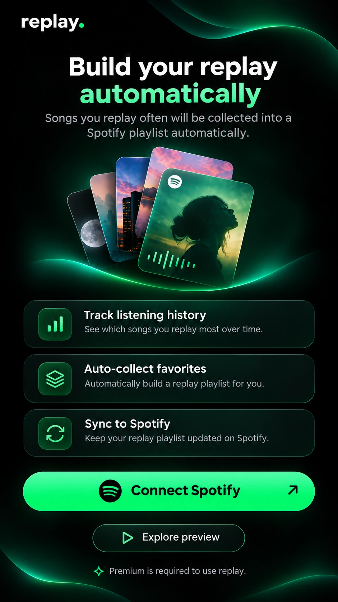
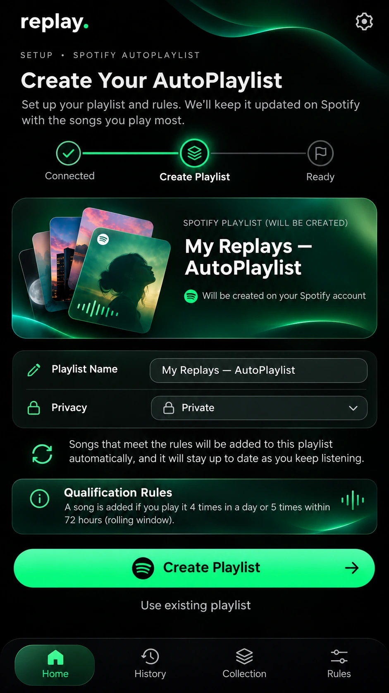
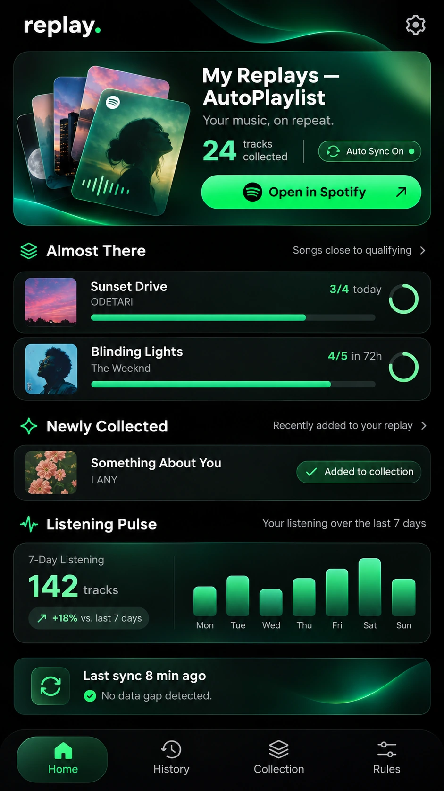
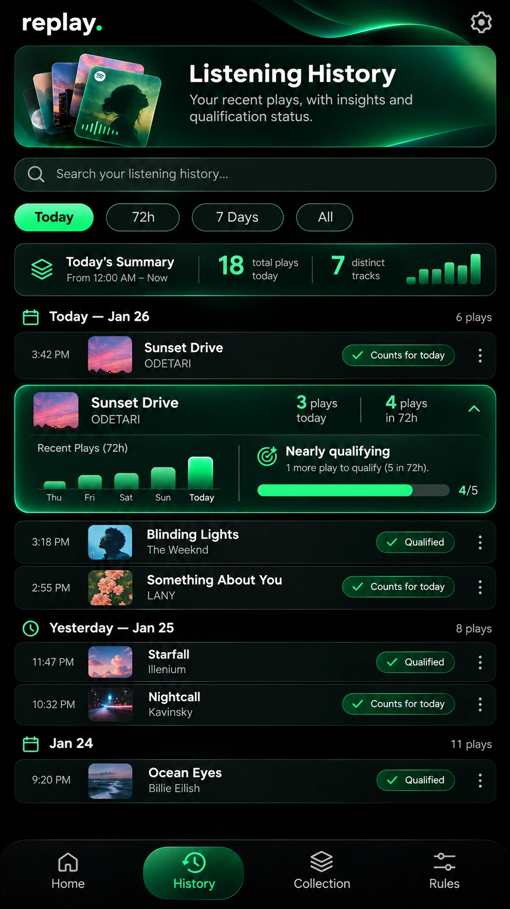
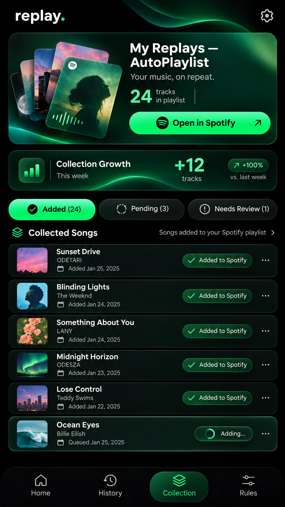
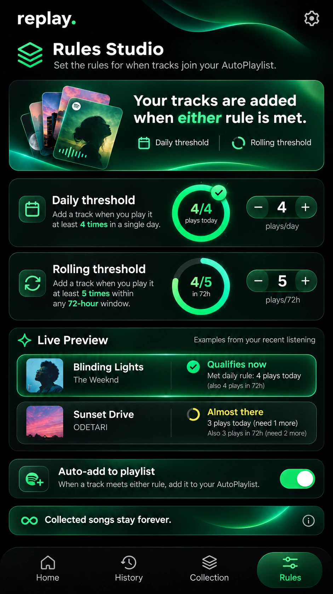
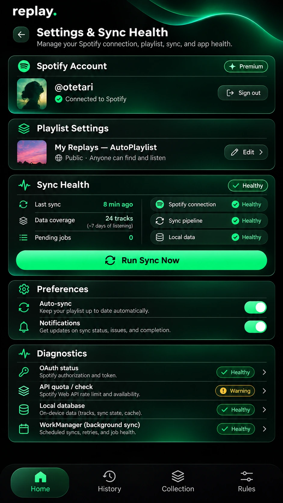
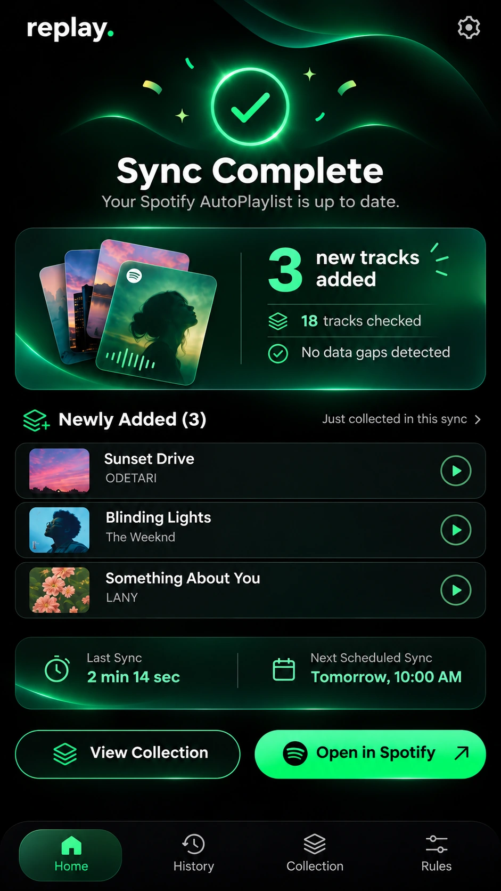
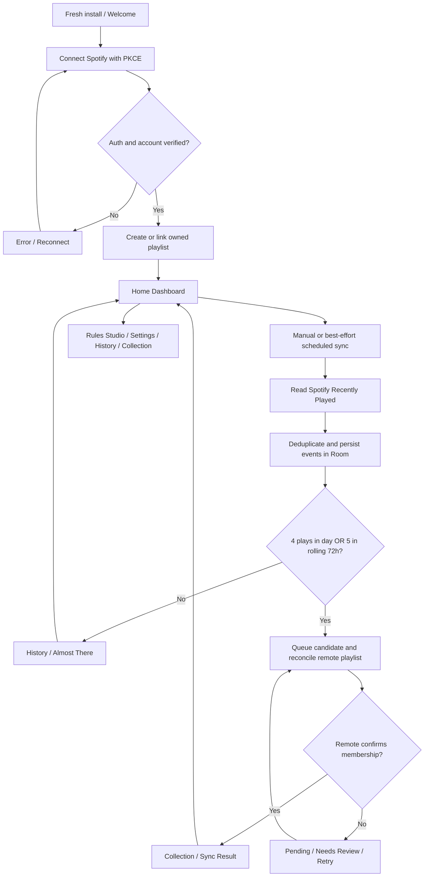

# UI Visual Reference — Spotify Neo × Replay Lab

> Version **1.3.0** · 2026-11-04 · Exact eight original visual concept PNGs from design discussion.

## Important: visuals are design targets, NOT screenshots of running software

All eight files below are original generated reference images. Keep the images unchanged as baselines. Implement the UI as native, accessible, interactive **Jetpack Compose** widgets. Never embed full reference screenshots as screen backgrounds, or hard-code depicted play counts, account names, track names, cover art, sync times, dates, states or percentages into production UI.

Use `docs/06-UI-UX.md`, `docs/02-BUSINESS-RULES.md`, and `docs/04-SPOTIFY-API.md` as functional contracts if an image conflicts with the actual MVP. See `docs/UI-VISUAL-DEVIATIONS.md` for intentional corrections.

## Eight screens — visual-to-task mapping

| Screen | Reference image | Codex task | Interaction | Entry condition |
|---|---|---|---|---|
| UI-00: Welcome / OAuth | [`00-welcome.png`](../design/reference/00-welcome.webp) | `TASK-050B` | Connect Spotify | first install, disconnected account; browser OAuth |
| UI-00B: Playlist Setup | [`01-playlist-setup.png`](../design/reference/01-playlist-setup.webp) | `TASK-050B` | Create Playlist | only after verified OAuth; optional existing-owned-playlist path conditional |
| UI-01: Home Dashboard | [`02-home.png`](../design/reference/02-home.webp) | `TASK-050C` | Open in Spotify / Sync now | default tab, real counts, near-threshold songs, coverage |
| UI-02: Listening History | [`03-listening-history.png`](../design/reference/03-listening-history.webp) | `TASK-050D` | search / filter / detail | chronological plays, progress and partial coverage |
| UI-03: Collection | [`04-collection.png`](../design/reference/04-collection.webp) | `TASK-050E` | Added / Pending / Needs Review | remote playlist verification authoritative |
| UI-04: Rules Studio | [`05-rules-studio.png`](../design/reference/05-rules-studio.webp) | `TASK-050F` | edit thresholds / save | 4/day OR 5/72h defaults, retained songs |
| UI-05: Settings & Sync Health | [`06-settings-sync-health.png`](../design/reference/06-settings-sync-health.webp) | `TASK-050G` | Run Sync Now / reconnect | account, diagnostics, error and offline states |
| UI-06: Sync Result | [`07-sync-complete.png`](../design/reference/07-sync-complete.webp) | `TASK-050G + TASK-051` | View Collection / Open Spotify | only show success after confirmed remote writes |

## Exact visual assets and embedding

Reference PNGs are copied **unchanged** into `design/reference/`; keep this folder tracked in Git. For markdown preview:

### UI-00 — Welcome / OAuth

### UI-00B — Playlist Setup

### UI-01 — Home Dashboard

### UI-02 — Listening History

### UI-03 — Collection

### UI-04 — Rules Studio

### UI-05 — Settings & Sync Health

### UI-06 — Sync Result

## Visual implementation checklist (per screen)

- [ ] Layout hierarchy follows reference (headline, hero, list, controls, navigation).
- [ ] AMOLED black, emerald gradient, typography and reusable tokens match `06-UI-UX.md`.
- [ ] Native scroll, safe-area insets, touch targets >=48dp, scalable fonts, TalkBack.
- [ ] All depicted actions navigate or cause an actual defined effect; unsupported pictured actions are hidden/disabled with explanation.
- [ ] All production figures/artwork are real or explicitly unknown/empty; fixtures appear only in previews/tests.
- [ ] All state variants supported: loading, empty, offline, partial coverage, auth required, pending, error.
- [ ] No claim of playlist addition until remote membership verified.
- [ ] Screenshot captured on OnePlus Ace 5 and compared against reference; record visual deviations and rationale.
- [ ] UI tests + CI compile pass, and manual checkpoint where specified.

## Workflow for the finished MVP

### User navigation and critical states

- **First run:** Welcome → Spotify browser login → account check → playlist setup → Home. If access denied or callback fails, display actionable error and retry.
- **Normal use:** Home ↔ History ↔ Collection ↔ Rules; Settings is accessed via Home gear.
- **Background:** WorkManager attempts best-effort sync; no fixed exact time guarantee. A notification or separate full-screen success screen is NOT required; prefer in-app confirmation after a user-triggered manual sync.
- **Sync feedback:** `Sync Complete` view is reached only after a successful manual sync with verified result; if zero newly added tracks, say `Đồng bộ thành công — không có bài mới`, not a fabricated 3.
- **Failures:** offline, insufficient API access, token expiry, 429, data gaps, playlist mismatch → truthful state and appropriate retry/reconnect path.
- **Account change:** explicit sign-out/reconnect; prevent cross-account event and playlist mixing.

## Suggested Codex visual iteration

1. Implement `TASK-050A` shared tokens/components with preview fixtures.
2. Implement and validate **Home** (`TASK-050C`) from `02-home.png` first, building a real native tree.
3. Reuse those components for Welcome, Setup, History, Collection, Rules, Settings and Sync Result.
4. Compare actual screenshots with the **unchanged** WebP reference at the same viewport/aspect ratio; iterate on layout/padding/colors before broad feature integration.
5. Wire UI to ViewModels and repositories; remove all demo content from production paths.

See `design/README.md` for asset inventory and `docs/UI-CODEX-PROMPTS.md` for ready-to-run prompts.
